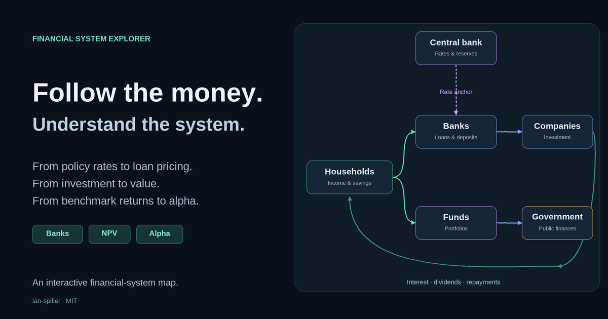

# Financial System Explorer

A visual, interactive explanation of how money, financing and interest rates connect the financial system.

**Interactive map:** [Open Financial System Explorer](https://ian-spiller.github.io/financial-system-explorer/)

**Open locally:** download this project and open [index.html](index.html) in a modern browser. No installation or build step is needed.

## What you can explore

- **Households:** consumption today versus tomorrow, MRS, saving, borrowing and the lifetime budget.
- **Commercial banks:** maturity transformation, liquidity and rate risk, funding costs and loan pricing.
- **Central bank:** demand, inflation, policy rates and the balance-sheet mechanics of QE.
- **Government:** deficits, refinancing and the feedback between interest costs and debt.
- **Companies:** invested capital, required return, annual surplus, NPV and firm value.
- **Funds:** investor goals, allocation, active/passive implementation, benchmarks and factor attribution.

Stock and bond valuation are linked from Funds and the shared **Interest rates** overview. The central tile connects planned saving, company investment, public deficits, ECB policy stance and required returns. Two rate cards connect to one graph; a horizontal row of numerical boxes then shows neutral reference → ECB rate → market base → risk premia → required returns. All six lessons link to the relevant part of this overview. Funds follows investor goals → allocation → implementation → benchmark and return attribution. Click or tap the central tile to open it; hovering only highlights it. Explore participants in the order you choose.

## Use the map

Click or tap a participant. On narrow screens the map becomes a readable participant flow. Use **Tab** to move between controls, **Enter** or **Space** to activate them, and **Escape** to close a dialog.

Hosted card links use hashes such as `#banks`, `#firms`, `#funds`, `#bonds`, `#cb` and the shared overview `#rates`. **Copy link** is available when hosted over HTTP or HTTPS. Links open the initial example; they do not save every input choice. **About this map** opens project information and sources.

## Hosting

This static site is ready for GitHub Pages. The source is self-contained and can also be opened locally.

If the repository or domain changes, update the site metadata with:

`node scripts/set-site-url.mjs https://your-actual-site.example/`

The social preview is an original conceptual illustration.

## Development and checks

The application is deliberately self-contained in `index.html`: HTML, CSS, SVG and plain JavaScript. It has no framework, analytics, cookies, account system or external data feed. Source links open external websites.

Run the supplied checks with Node.js 20+ and Python 3.10+:

`node scripts/check.mjs`

`python scripts/check-html.py`

Checks cover model identities, loan pricing, NPV, factor attribution, deep-link validation and HTML structure. They do not replace a visual browser review. The repository workflow runs these checks on pushes and pull requests.

## Scope and assumptions

This is an educational model with a euro-area focus, not a complete representation of every market or jurisdiction. Numbers are fictional teaching assumptions, not current quotes or personal recommendations. Some lessons share the bank quote; other lessons deliberately use separate budgets, securities or return periods.

See [EDUCATIONAL-NOTES.md](EDUCATIONAL-NOTES.md) for the model boundaries and [SOURCES.md](SOURCES.md) for references. Developed through an iterative human–AI collaboration.

## Feedback

Corrections are welcome. Please identify the participant, the selected inputs and the statement or calculation you would change. For layout issues, include the browser, screen width and a screenshot.

## License

[MIT](LICENSE), copyright 2026 ian-spiller. The license covers this project's code and original graphics; referenced publications retain their own rights.
