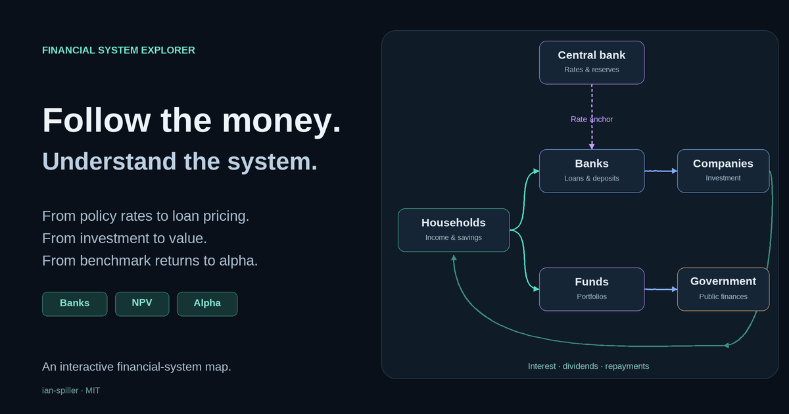

# Financial System Explorer

A visual, interactive explanation of how saving, financing and interest rates connect the financial system.

**[Open the interactive map](https://ian-spiller.github.io/financial-system-explorer/)**

The existing site URL always opens the current published version.

## Explore the system

- **Households:** consumption today versus tomorrow, saving, borrowing and the transition to portfolio choice.
- **Commercial banks:** maturity transformation, liquidity versus solvency, funding, hedging and loan pricing.
- **Central bank:** demand, inflation, the ECB response and the balance-sheet mechanics of QE.
- **Government:** actual EU27 revenue and spending shares, followed by a teaching example of deficits, refinancing and debt-interest costs.
- **Companies:** operating profit → free cash flow to the firm → cost of capital → surplus → NPV.
- **Funds:** goals, risk capacity and willingness → Markowitz allocation → policy benchmark → active/passive implementation → realized-return attribution.

The central **Interest rates** view connects saving supply and financing demand to natural and policy rates, market references and required returns. Bond and stock valuation open from relevant cards. Shared Neutral, Cooling and Supporting scenarios update the connected examples.

## Use the map

Click or tap a participant or Interest rates. Follow the contextual links to related calculations. Tab moves between controls; Enter or Space activates them; Escape closes a dialog. Direct links such as #banks, #firms, #funds, #state, #cb, #households and #rates open the corresponding view with its initial assumptions.

Download the project and open [index.html](index.html) locally. No installation, account or build step is needed.

## Data and teaching assumptions

The government composition uses Eurostat's EU27 general-government data for **2024**, retrieved on **17 November 2026**. These are national-account measures, not a cash-only budget or the budget of EU institutions. The revenue and expenditure charts use their respective published totals.

Rates, company cash flows, bank pricing and portfolio outcomes are **hypothetical teaching examples**, not current quotes or observed investment results. They illustrate connected mechanisms rather than a fully calibrated economy.

[Model notes](EDUCATIONAL-NOTES.md) · [Sources](SOURCES.md)

## Previous version and video

[Complete previous published version](https://github.com/ian-spiller/financial-system-explorer/tree/archive/published-before-upgrade-2026-11-19) — preserved before this update.

[Updated overview video (1:59)](https://ian-spiller.github.io/financial-system-explorer/video/) · [Download MP4](assets/financial-system-explorer-overview.mp4?v=20261119) · [English captions](assets/financial-system-explorer-overview-English.srt). The video shows the current explorer, including the EU government profile, FCFF and Markowitz allocation.

## Checks and hosting

The site uses self-contained HTML, CSS, SVG and JavaScript. GitHub Pages publishes the main branch at the existing URL. It has no analytics, cookies or external data feed.

Run the model checks with Node.js 20+ and Python 3.10+:

- node scripts/check.mjs
- python scripts/check-html.py

Checks cover cross-card pricing scenarios, financial identities, portfolio optimization and attribution, routing, local assets and rendered HTML. Browser review complements these checks.

Corrections are welcome: identify the card, selected inputs and calculation or statement concerned.

## License

[MIT](LICENSE), copyright 2026 ian-spiller. Referenced publications retain their own rights. Developed through an iterative human–AI collaboration.
